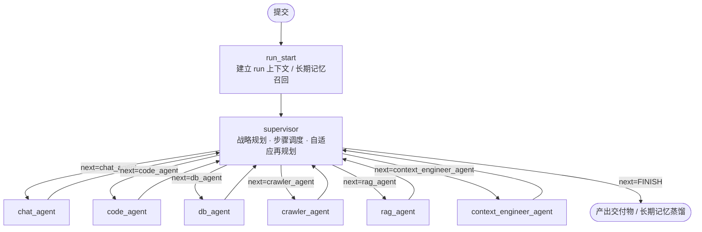

# Multi-Agent Research Runtime

面向长周期研究任务的 **多智能体执行运行时**，以及一套用于**让运行时自身可被度量、可被迭代**的实验基础设施。

系统在 LangGraph 上构建「规划—执行—再规划」的监督者-成员架构，解决长任务中的四类工程问题：计划漂移、子任务质量不可判定、上下文溢出、执行过程不可观测。其上的 `adaptive_runtime` 把「改进运行时」本身变成一个受控实验：固定评分口径、用统计判据决定某个改动是否真的有效、并拒绝自证。

> 本仓库包含两个交付物：**运行时本体**（可直接跑真实研究/分析任务）与 **自优化实验层**（对运行时做受控对照实验，产出可审计的结论）。

---

## 1. 问题定义

大模型 Agent 在分钟级任务上表现良好，但在小时级、多阶段、需要产出可交付物的任务上会系统性失稳。本项目针对的是一组具体的失败模式，而非泛泛的「让 Agent 更聪明」：

| 失败模式         | 观测到的表现                  | 本系统的处理方式                                                          |
| ------------ | ----------------------- | ----------------------------------------------------------------- |
| 计划漂移         | 后续步骤与既定目标脱节，计划被逐步改写     | 目标在首次规划后锁定；再规划只允许调整未完成步骤，并设空转熔断                                   |
| 子任务质量不可判定    | LLM 自评「已完成」，但产物为空或与动作不符 | 规则门 → 动作契约门 → LLM 评审门，三级串联，任一级不通过即视为该步失败                          |
| 失败不可归因       | 下游 agent 重复上游同样的错误      | 失败写为结构化记录（`kind` / `reason` / `hint` / `attempt`），作为显式上下文交给下一个执行者 |
| 上下文溢出        | 长任务中期开始丢早期约束，或直接触顶报错    | 跨步语义摘要 + 分层压缩，摘要按「已折叠条数」增量推进                                      |
| 跨 Agent 交接丢失 | 上游算出的中间结果在消息里被截断        | 中间产物落盘，路径作为交接通道，消息只传递引用                                           |
| 过程不可观测       | 只能看到最终输出，无法定位耗时与成本分布    | 每次提交独立 run 日志：节点级耗时、工具调用、计划变更、Token 用量                            |
| 不可逆操作        | Agent 直接执行删除、发信、任意 SQL  | 工具按 safe / warn / danger 分级，danger 级调用前中断等待人工确认                   |
| 无法评估「改得对不对」  | 靠体感判断提示词改动是否有效          | `adaptive_runtime`：固定评分口径 + 噪声调整门限 + 受控对照                         |

---

## 2. 架构



### 2.1 调度层：Supervisor

- **一次性战略规划**：首次进入时由 Supervisor 输出结构化计划（目标 + 有序步骤），此后目标不再改变。
- **顺序执行 + 自适应再规划**：每步完成后根据观测重组剩余步骤；若再规划前后计划无变化（空转），累计计数达阈值即停用再规划，避免无效循环消耗预算。
- **收尾对账**：存在失败步骤时，由 Supervisor 做一次显式决策（补做 / 降级交付 / 明确声明未完成），不允许静默丢弃。

### 2.2 执行层：成员 Agent

| *Agent*                    | *职责*                    | *主要工具*                                        |
| -------------------------- | ----------------------- | --------------------------------------------- |
| *`chat_agent`*             | *澄清、轻量问答、结果整合*          | *对话 + 检索*                                     |
| *`crawler_agent`*          | *外部信息采集与正文抽取*           | *`resilient_tavily_search`、文件读写、`grep_files`* |
| *`code_agent`*             | *代码生成与执行、数据分析、图表*       | *`python_repl`、`shell_exec`、`str_replace`*    |
| *`db_agent`*               | *自然语言转 SQL、Schema 感知查询* | *`execute_sql`、`query_table_schema`、CRUD 工具*  |
| *`rag_agent`*              | *计划式检索 + 自评*            | *检索 + `evaluate_output`*                      |
| *`context_engineer_agent`* | *上下文快照存取、压缩与恢复*         | *`save_context_snapshot`、`restore_snapshot`*  |

工具层共 24 个受控工具，覆盖检索、代码执行、文件系统、SQL、邮件与行情数据；均通过统一封装纳入结构化日志与风险分级。

### 2.3 质量与可靠性机制

| 机制     | 模块                        | 要点                                                                   |
| ------ | ------------------------- | -------------------------------------------------------------------- |
| 三级质量门  | `agents.py`               | 规则门（可判定字段）→ 动作契约门（声明动作是否真实发生）→ LLM 评审门（带重试预算）；任一失败记入 `step_failures` |
| 失败反馈闭环 | `handoff.py`              | 失败按 `recursion` / `exception` / `critic` 归因，生成「可操作改进要求」注入下一个执行者      |
| 跨步摘要   | `summary.py`              | 已完成步骤的观测压缩为要点清单，作为下游 agent 的跨步上下文                                    |
| 上下文压缩  | `compress.py`             | 分层压缩策略，触顶前主动收缩，保留约束类信息                                               |
| 长期记忆   | `longterm.py`             | 向量语义召回 + SQLite 持久化；本轮蒸馏结果写回，供后续会话召回                                 |
| 人机协同   | `hitl.py`                 | safe 放行 / warn 记录 / danger 中断确认；开关默认关闭，关闭时行为与改造前一致                   |
| 可观测性   | `runlog.py`               | 每次提交独立 run 日志：节点耗时、计划变更、工具调用、异常栈、Token 用量                            |
| 快照与回滚  | `tools.py` / `context.py` | 关键节点快照，可回滚到指定状态并可视化                                                  |

设计约束：新增能力一律以**开关 + 默认零行为变更**的方式接入，保证任一机制可被单独关闭而不影响既有链路。

---

## 3. Adaptive Runtime：把「改进运行时」做成受控实验

### 3.1 目标与边界

让 Agent 在**不改动模型权重**的前提下，通过搜索 harness（参数 / 提示 / 控制流）提升任务质量，并对每一次「提升」给出统计判据。

三条硬不变量：

1. **评分口径不可被优化对象修改** —— 评分链路由符号级哈希与解析后环境哈希双重断言锁定；
2. **模型冻结** —— 只搜索 harness，不训练；
3. **证据不完整即判失败** —— 任一实验臂缺失 run，整轮结论记为 `INCOMPLETE_EVIDENCE`，而非按缺失数据重归一化。

### 3.2 质量指标

```
Q = 100 × (0.50·A + 0.30·E + 0.20·C)

A = 通过质量门的步骤数 / 计划步骤数         （契约达成率）
E = 带来源的关键数字数 / 关键数字总数        （证据率）
C = 1 − 缺陷项 / (计划产物数 + 1)           （完整性：截断 / 兜底 / 缺失产物）
```

三项均有下界保护：无报告记 `E = 0`（视为失败信号，不重归一化权重）；交付物需同时满足最小体积与结构分，否则按「无报告」处理。

### 3.3 判定：非补偿门

改进必须**同时**满足证据充分性与方向正确性，任一维度不达标即否决，不允许用其他维度的收益补偿：

| 门           | 检查项                                      |
| ----------- | ---------------------------------------- |
| Gate A（合法性） | 评分器未被改动 · 无测试集泄漏 · 无惰性参数 · 预算未超 · 编辑预算合规 |
| Gate B（有效性） | 证据完整 → 契约地板 → 判分稳定性 → 回归率 → 配对增益 → 成本规则  |

配对增益使用噪声调整门限，而非固定阈值：

```
δ = t_{1−α/2, n−1} · sd(Δ) / √n
ACCEPT(VALIDATED) ⟺ mean(Δ) > δ
```

统计口径的两个关键选择：**先按任务聚合再检验**（避免同一任务的重复执行虚增自由度），以及 **n < 2 直接判证据不足**（单任务证据在原理上无法回答「是否普遍有效」）。

### 3.4 演化层级与准入

| 层级     | 对象                                   | 可枚举性      | 默认状态                             |
| ------ | ------------------------------------ | --------- | -------------------------------- |
| L1 参数  | 迭代预算、解析重试、再规划门槛等运行时参数                | 完全可枚举     | 开启                               |
| L2 提示  | 角色提示补丁（锚点唯一性在导入期校验，补丁只作用于候选沙箱并做语法校验） | 半可枚举（模板库） | 由 `ADAPTIVE_MAX_EDIT_LEVEL=2` 开启 |
| L3 控制流 | 再规划上限、观测窗口等结构性改动                     | 可枚举但语义耦合  | 保持关闭                             |

L3 保持关闭的理由是**验收能力**而非实现进度：控制流改动一旦引入回归，无法区分「方向错误」与「实现缺陷」，需要先建立 L1/L2 的稳定处理曲线。

### 3.5 反刷分

指标一旦可被博弈，闭环会以远超人工的速度学会博弈。已封堵的两条通道：

- **空壳交付物**：一句话文档曾可获 `Q = 70`。现要求体积下限 + 结构分（标题 / 列表或表格 / 结论段），且结构分作为完整性乘数。
- **削减计划换取高分**：`A` 与 `C` 的分母均来自 Agent 自身计划，缩短计划即可抬高比值。现增加 `plan_undercut` 判定：计划显著缩短**且**契约率上升时记为刷分，过半配对出现即否决；仅拦截这一组合，不误伤真实效率改进。

### 3.6 经验与防重复

失败假设不得原样重提（假设台账按特征去重）；候选被拒时归档证据而非丢弃，便于按补丁指纹查重；连续多次判为「噪声内」的组件进入休眠并输出「该组件无效」的结论，避免搜索空间无限膨胀。

---

## 4. 验证体系

分三层，每层回答一个不同的问题，且成本依次上升：

| 层级 | 问题          | 手段                            | 成本       |
| -- | ----------- | ----------------------------- | -------- |
| 1  | 判定器会不会自欺    | 受控对照：零改动 / 故意变差 / 同名双臂 / 真实改进 | 零 LLM 成本 |
| 2  | 单个改动是否真的有效  | 配对 t 检验 + 噪声调整门限              | 分钟级      |
| 3  | 多轮之后是否真的在变强 | 连续多轮闭环，观察 ΔQ 序列与 holdout 平稳性  | 小时级      |

第 1 层包含阴性对照（必须拒绝）与阳性对照（必须接受）：只能拒绝的判定器看似严谨、实际无用；只能接受的判定器会破坏整个系统。

### 4.1 真实验证数据

单个真实研报任务的基线臂实测：

| 指标       | 实测值                                           |
| -------- | --------------------------------------------- |
| 运行时长     | 1108.6 s                                      |
| LLM 调用   | 58 次                                          |
| Token 消耗 | 649,632（真实 usage 占比 95.1%）                    |
| 得分       | `Q = 73.02`（A = 1.00 / E = 0.1007 / C = 1.00） |
| 产物       | 14 个，缺失 0                                     |

由此得到两个可用于决策的结论：

1. **改进方向由数据确定**：契约率与完整性已满分，27 分的差距几乎全部来自证据率（268 个关键数字中仅 27 个带来源）。证据率是当前唯一有意义的优化目标。
2. **噪声量级必须实测**：同一任务、同一份代码两次运行，`Q` 相差 24.45 分。按此估计单次运行 σ ≈ 24，n = 8 时门限 δ ≈ 20 分 —— 小于 20 分的改进在该样本量下不可检出。这直接决定了实验规模：要检出 +10 分需 n ≈ 47，要检出 +20 分需 n ≈ 12。

这套体系只对大改进敏感，这是研报类任务产出方差大的必然结果，而非实现缺陷。配置中的 `sd_diff_target` 已按实测从 6.0 调整为 15.0，并在启动时对「δ 过大导致本轮必然不可检出」给出告警。

### 4.2 复现

```bash
# 判定器自检（含阴性/阳性对照，零 LLM 成本）
python -m adaptive_runtime.run_adaptive selftest

# 冻结校验（评分链未被改动）
python -m adaptive_runtime.run_adaptive verify

# 运行时状态：阈值、基线、假设台账、演化状态
python -m adaptive_runtime.run_adaptive status

# 单轮闭环（真实任务 / 模拟轨迹）
python -m adaptive_runtime.run_adaptive round --tasks-file experiments/tasks/replay.json
python -m adaptive_runtime.run_adaptive round --fake --case good

# 多轮闭环：ΔQ 序列 + holdout 平稳性
python -m adaptive_runtime.run_adaptive benchmark --rounds 3 --n 4 --limit 12 --holdout 0.3

# 单元与集成测试
python -m unittest discover -s adaptive_runtime/tests -t .
```

---

## 5. 快速开始

```bash
# 1. 环境与依赖（Python 3.13；LangChain 1.4 / LangGraph 1.2 已锁定版本）
powershell -ExecutionPolicy Bypass -File setup_env.ps1
# 或手动：python -m venv .venv && .venv\Scripts\pip install -r requirements.txt

# 2. 配置：LLM_BASE_URL / LLM_API_KEY / LLM_MODEL 为必填项，
#    检索、数据库、邮件凭据按需填写；其余 AGENT_* 为可选开关与阈值
#    （键位与默认值见 config.py 及各模块 docstring）

# 3. 直接运行一次带记忆的调用
python agent.py

# 4. 或以 LangGraph 服务方式启动（平台托管持久化与可视化）
langgraph dev
```

`.env` 中的 `AGENT_*` 均为独立开关与阈值，未设置时使用代码内默认值；所有开关的默认值对应「与引入该机制之前行为一致」。

---

## 6. 目录结构

```
.
├── graph.py                 # 图装配、Checkpointer 选择、快照可视化
├── supervisor.py            # 规划 / 调度 / 再规划 / 收尾对账
├── agents.py                # 成员 Agent 工厂、三级质量门、失败归因
├── plan.py / planutil.py    # 计划解析、进度标记、再规划引擎、路由配置
├── state.py                 # 全局状态 schema（单一真源）
├── handoff.py               # 任务下发与产物落盘（跨 Agent 交接通道）
├── summary.py / compress.py # 跨步摘要 / 上下文压缩
├── longterm.py              # 跨会话长期记忆（向量召回 + SQLite）
├── hitl.py                  # 工具风险分级与人工确认
├── runlog.py                # 每次提交独立的结构化运行日志
├── tools.py                 # 24 个受控工具
├── prompt.py                # 各角色提示模板
├── llm.py                   # 模型实例与中间件装配
├── embed_server_light.py    # 本地 embedding 服务（OpenAI 兼容）
├── adaptive_runtime/        # 自优化实验层：27 个模块 + 165 个测试
│   ├── evaluator.py         # 质量指标与判分口径版本
│   ├── gate.py              # 非补偿判定门
│   ├── stats.py             # 配对统计与样本量反推
│   ├── frozen.py            # 评分链路符号级冻结
│   ├── proposer.py          # 候选生成（参数 / 提示补丁）
│   ├── probe.py             # 候选沙箱与两级 Racing
│   ├── evolution.py         # 探索与淘汰
│   ├── ledger.py            # 假设台账（拒绝重复假设）
│   ├── benchmark.py         # 多轮闭环与 held-out 平稳性
│   └── tests/               # 165 个单元 / 集成测试
└── docs/                    # 设计与验证文档（见 docs/README.md）
```

生产链路的六个文件（`agents.py` / `plan.py` / `planutil.py` / `llm.py` / `runlog.py` / `graph.py`）由冻结校验保护，实验层不修改它们；演化通过子进程环境变量覆盖生效，因此实验双臂共享同一份代码。

---

## 7. 当前状态

| 项目           | 状态                                                      |
| ------------ | ------------------------------------------------------- |
| 运行时本体        | 可跑真实研究 / 分析任务，单次 18 分钟级任务完成端到端验证                        |
| 自适应实验层       | 27 模块 / 165 测试全绿；判定器自检 9/9（含阴性、阳性、敏感性对照）                |
| 生产文件逻辑改动     | 0 处（由 `verify` 机器校验）                                    |
| L1 参数演化      | 已开启并通过真实两臂对比                                            |
| L2 提示演化      | 已接通，可产出 4 条提示补丁候选并经沙箱 diff 验证生效；L2 rubric 仅作次要证据，不进入主判定 |
| 多轮 benchmark | 管线就绪，按统计检出能力排期执行（见 §4.1）                                |

### 7.1 已知边界

- **L3 控制流演化未开放**：需要先建立 L1/L2 的稳定处理曲线，否则无法区分方向错误与实现缺陷。
- **基线推进不自动发生**：`promote` 强制要求人工操作者，系统不得为自己升基线。
- **跨任务经验迁移的净收益尚未单独度量**：需要「注入经验 / 不注入」的对照实验，当前只完成组装环节。
- **弱化版轨迹对比**：严格版需要同一任务多次重复执行的有成有败数据，当前仅有历史单次日志，不做插值补全。

---

## 8. 参考

- RRSI — Regularized Recursive Self-Improvement：<https://regularized-rsi.com/>
- LangGraph 状态图与持久化：<https://langchain-ai.github.io/langgraph/>

---

## 9. 界面与产物示例

<details>

<summary>展开：研究任务执行、数据库查询、Text2SQL、Agentic RAG、代码分析、研报产出与邮件投递</summary>

| 场景                        | 截图       |
| ------------------------- | -------- |
| 多 Agent 协作执行研究任务          | research |
| 数据库读写                     | db       |
| Text2SQL：自然语言生成 SQL 并返回结果 | text2sql |
| Agentic RAG：计划 + 自评       | rag      |
| 代码生成与数据分析                 | code     |
| Markdown 研究报告产出           | report   |
| 研报邮件投递                    | mail1    |
| 投递结果                      | mail2    |

</details>
